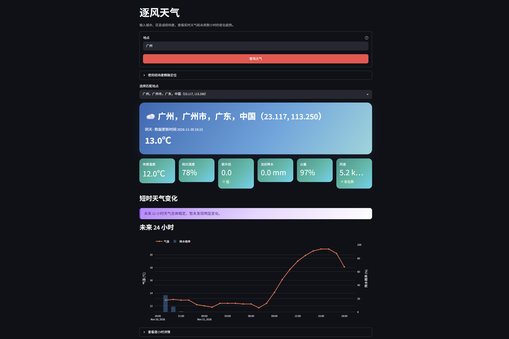

# 逐风天气 | Zhufeng Weather

基于 **Python + Streamlit** 的交互式天气查询与数据分析项目。使用 **Open-Meteo API** 获取天气预报和历史气温数据，无需申请 API Key。

> 个人课程项目与作品集展示；并非商业级气象预警服务。

## 已实现功能

- **天气查询**：城市、区县地点搜索或输入经纬度；查看当前气温、体感温度、湿度、云量、风速和风向。
- **天气可视化**：展示未来 24 小时逐时气温和降水概率，以及未来 3 天天气概览。
- **变化提醒**：依据未来 12 小时预报数据识别天气类型转换、降水、明显升降温和强风。
- **规则式天气简报**：根据天气字段和预设文字规则输出中文简报，**不依赖大语言模型（LLM）**。
- **ARIMA 气温预测**：调用 Open-Meteo 历史天气接口，使用 `statsmodels` 的 ARIMA 模型预测未来 5 天气温，展示 AIC 和置信区间；这是学习性实验，与官方天气预报不同。
- **K-Means 天气聚类**：基于预报中每日温度、降水概率和 UV 指数等特征进行演示性聚类；由于默认只取 3 天预报数据，结果仅作功能演示，不代表可靠的气象分类结论。

## 技术栈

| 用途 | 工具 |
| --- | --- |
| 页面与图表 | Streamlit、Plotly |
| API调用 | requests、Open-Meteo |
| 数据处理 | pandas、NumPy |
| 统计与机器学习 | statsmodels（ARIMA）、scikit-learn（K-Means） |
| 测试 | pytest |

## 本地运行

建议使用 Python 3.10 或更高版本。在项目根目录执行：

```bash
python -m pip install -r requirements.txt
python -m streamlit run app.py
```

页面通常会在 `http://localhost:8501` 打开；运行天气查询需要网络连接。

## 运行测试

```bash
python -m pytest -q
```

测试主要覆盖天气简报规则、地点匹配、变化提示、ARIMA函数和天气聚类等逻辑；**它们不能替代带网络连接的端到端页面测试**。

## 项目结构

```text
zhufeng-weather/
├── app.py                 # Streamlit页面、图表及交互
├── weather_service.py     # 地点搜索、天气接口、数据整理
├── weather_analysis.py    # 天气变化提醒规则
├── weather_codes.py       # 天气代码映射
├── weather_ml.py          # 规则式简报、ARIMA与K-Means
├── tests/                 # pytest测试用例
├── requirements.txt       # Python依赖
├── .gitignore             # 排除缓存、虚拟环境和私密配置
└── README.md              # 项目说明
```

## 运行截图

```markdown

```

## 数据来源与限制

- 天气预报和历史气温数据来自 [Open-Meteo](https://open-meteo.com/)。
- 变化提醒由预报阈值生成，**不是气象部门发布的官方预警**。极端天气请以当地气象部门信息为准。
- ARIMA 使用历史日平均温度进行短期预测；模型结果未经独立长期回测，不应宣称具有经过验证的预测精度。
- 天气简报为规则/模板生成，不是 LLM、RAG 或 Agent 项目。

## 个人工作

项目代码包含 Streamlit 页面组织、Open-Meteo 接口请求与数据解析、天气分析规则、ARIMA / K-Means 模块及 pytest 测试。
